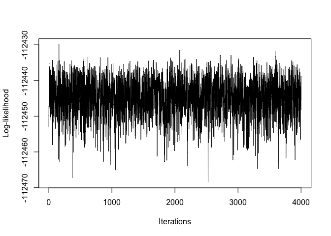
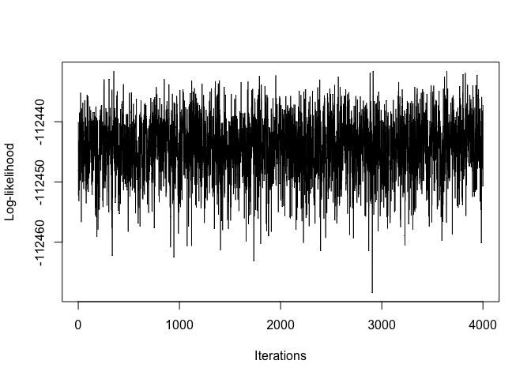
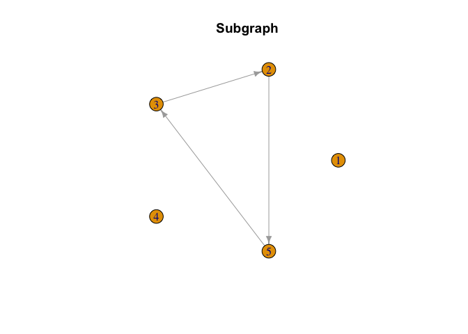
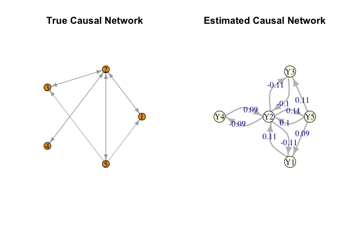

<!-- README.md is generated from README.Rmd. Please edit that file -->

# MR.RGM

<!-- badges: start -->

[](https://github.com/bitansa/MR.RGM/actions/workflows/R-CMD-check.yaml)
[](https://CRAN.R-project.org/package=MR.RGM)
[](https://CRAN.R-project.org/package=MR.RGM)
<!-- badges: end -->

**Please use version 0.1.3 or later.** Versions 0.1.1 and earlier contain errors in the samplers that are fixed in 0.1.2 and 0.1.3 (details in [NEWS](https://github.com/bitansa/MR.RGM/blob/master/NEWS.md)). Update with `install.packages("MR.RGM")` and check with `packageVersion("MR.RGM")`.

## Intended use of the package

MR.RGM fits Bayesian reciprocal graphical models for instrumental-variable (IV) analysis of several responses at once. From instruments `X`, responses `Y` and optional measured covariates `U`, `RGM()` estimates the direct causal effects among the responses, which may form directed cycles, the effects of the instruments, and the structure of unmeasured confounding among the responses, with a posterior inclusion probability for every edge and every confounding link. `NetworkMotif()` gives the posterior probability of any set of edges, such as a feedback loop. The package is named after its first application, Mendelian randomization (MR), in which genetic variants are the instruments, but the model applies to instrumental variables in general.

RGM accommodates both individual-level data and two types of
summary-level data, making it adaptable to various data availability
scenarios. In addition, RGM optionally allows the inclusion of observed
covariates, enabling adjustment for measured confounders when such
information is available. Covariates can be incorporated using either
individual-level data or corresponding summary-level matrices.

The outputs of `RGM()` include the estimated causal effects and their inclusion probabilities, the instrument and covariate effects, the error covariance and, under the `"SSSL"` error model, the inclusion probabilities of its off-diagonal entries, which describe unmeasured confounding between pairs of responses. `RGM()` also returns diagnostics of weak instruments, weak identification and convergence, with a warning when one of them signals a problem.

## Installation instructions

You can install the released version of [MR.RGM from
CRAN](https://CRAN.R-project.org/package=MR.RGM) with:

``` r

    install.packages("MR.RGM")
```

You can install version 0.1.3, the version used for the analyses in
`reproducibility/`, from GitHub with:

``` r

    # install.packages("remotes")
    remotes::install_github("bitansa/MR.RGM")
```

The model has no intercept and the `"SSSL"` error model assumes
responses on roughly unit scale, so center and scale real data before
fitting (see `?RGM`).

The input can be individual-level data (`X`, `Y`, optionally `U`), the
second-moment matrices of one sample (`Syy`, `Syx`, `Sxx`, and `Syu`,
`Sxu`, `Suu` for covariates), or marginal instrument–response
regressions (`Sxx`, `Beta`, `SigmaHat`). The last input does not contain
the covariances between the responses, which are reconstructed under
independent errors: it therefore requires `SigmaStarModel = "diagonal"`,
no covariates, an instrument that affects only one response for every
response, and uncorrelated instruments, and `SigmaHat` holds the
residual sums of squares divided by `n`. Unmeasured confounding can be
modeled only from individual-level data or the second-moment matrices.

### Two versions: MR.RGM and MR.RGM+

The model applies to instrumental variables in general, not only to
genetic instruments; in the accompanying methods paper the two versions
are called IV-RGM and IV-RGM+.

The instrument–response map `D` (a binary `p x k` matrix, `D[i, j] = 1`
if instrument `j` may affect response `i`) decides which version is
fitted:

- **MR.RGM** (`D` with zeros, the usual case: each instrument assigned
  to its own response, e.g. a cis-eQTL to its gene): entries of `B` with
  `D = 0` are fixed at zero and the allowed entries receive a slab prior
  without selection, so every allowed instrument stays in the model. The
  causal effects are identified through the excluded instruments (rank
  condition).
- **MR.RGM+** (`D` all ones): every entry of `B` receives a
  spike-and-slab prior and the map is learned from the data, which
  accommodates horizontal pleiotropy. This needs instruments that
  explain a non-negligible share of the variance; with many weak
  instruments the fit is weakly identified and `RGM()` warns.

The argument `selectB` overrides this default (`selectB = TRUE` with a
partial `D` selects among the allowed entries; `selectB = FALSE` with
`D = 1` gives every entry a slab prior). The value used is stored in
`fit$settings$selectB`.

Once the MR.RGM package is installed load the package.

``` r

     library("MR.RGM")
```

## Example

The examples below use simulated data to illustrate `RGM()` with individual-level data, summary-level data and the alternative error models, and the estimation of the effects among the responses, of the instruments and, when present, of the covariates. The last example applies `NetworkMotif()` to the posterior draws `GammaPst` returned by `RGM()`.

``` r

# Model: Y = AY + BX + CU + E

# Set seed
set.seed(9154)

# Number of data points
n = 30000

# Number of response variables, instruments, and covariates
p = 5
k = 6
l = 2

# Initialize causal interaction matrix between response variables
A = matrix(sample(c(-0.1, 0.1), p^2, replace = TRUE), p, p)

# Diagonal entries of A matrix will always be 0
diag(A) = 0

# Make the network sparse
A[sample(which(A != 0), length(which(A != 0)) / 2)] = 0

# Create D matrix (Indicator matrix: rows = responses, cols = instruments)
D = matrix(0, nrow = p, ncol = k)

# Manually assign values to D matrix
D[1, 1:2] = 1
D[2, 3]   = 1
D[3, 4]   = 1
D[4, 5]   = 1
D[5, 6]   = 1

# Initialize B matrix (instrument effects)
B = matrix(0, p, k)
for (i in 1:p) {
  for (j in 1:k) {
    if (D[i, j] == 1) {
      B[i, j] = 1
    }
  }
}

# Generate covariate data matrix U (n x l)
U = matrix(rnorm(n * l), nrow = n, ncol = l)

# Initialize C matrix (covariate effects)
C = matrix(0, p, l)
C[sample(length(C), size = ceiling(length(C) / 2))] = 1

# Create a full (non-diagonal) positive definite error covariance matrix Sigma
R = matrix(rnorm(p * p), p, p)
Sigma = crossprod(R)                 # SPD

# Compute (I - A)^{-1}
Mult_Mat = solve(diag(p) - A)

# Variance of Y
Variance = Mult_Mat %*% Sigma %*% t(Mult_Mat)

# Generate instrument data matrix X
X = matrix(rnorm(n * k), nrow = n, ncol = k)

# Initialize response data matrix Y
Y = matrix(0, nrow = n, ncol = p)

# Generate response data
for (i in 1:n) {
  mu_i = Mult_Mat %*% (B %*% X[i, ] + C %*% U[i, ])
  Y[i, ] = as.numeric(mu_i + t(chol(Variance)) %*% rnorm(p))   # multivariate normal draw
}

# The model has no intercept and the SSSL prior assumes responses on unit scale:
# center and scale every column (the estimates are then on the standardized scale)
X = scale(X); Y = scale(Y); U = scale(U)

# Print true causal interaction matrices
A
#>      [,1] [,2] [,3] [,4] [,5]
#> [1,]  0.0 -0.1  0.0  0.0  0.1
#> [2,]  0.1  0.0 -0.1  0.1  0.1
#> [3,]  0.0 -0.1  0.0  0.0  0.1
#> [4,]  0.0 -0.1  0.0  0.0  0.0
#> [5,]  0.0  0.1  0.0  0.0  0.0
B
#>      [,1] [,2] [,3] [,4] [,5] [,6]
#> [1,]    1    1    0    0    0    0
#> [2,]    0    0    1    0    0    0
#> [3,]    0    0    0    1    0    0
#> [4,]    0    0    0    0    1    0
#> [5,]    0    0    0    0    0    1
C
#>      [,1] [,2]
#> [1,]    1    0
#> [2,]    1    0
#> [3,]    0    1
#> [4,]    0    0
#> [5,]    1    1
```

We will now apply RGM using individual-level data and summary-level data
to demonstrate its functionality.

``` r

# ---------------------------------------------------------
# Apply RGM on individual-level data with covariates (Spike and Slab prior)
# Model: Y = AY + BX + CU + E

Output1 = RGM(
  X = X, Y = Y, U = U,
  D = D, nIter = 50000, nBurnin = 10000, Thin = 10,
  prior = "Spike and Slab",
  SigmaStarModel = "IW"
)

# ---------------------------------------------------------
# Compute summary-level quantities (including covariates)
Syy = crossprod(Y) / n        # t(Y) %*% Y / n
Syx = t(Y) %*% X / n
Sxx = crossprod(X) / n        # t(X) %*% X / n

Syu = t(Y) %*% U / n
Sxu = t(X) %*% U / n
Suu = crossprod(U) / n        # t(U) %*% U / n

# Apply RGM on summary-level data with covariates (Spike-and-Slab prior)
Output2 = RGM(
  Syy = Syy, Syx = Syx, Sxx = Sxx,
  Syu = Syu, Sxu = Sxu, Suu = Suu,
  D = D, n = n, nIter = 50000, nBurnin = 10000, Thin = 10,
  prior = "Spike and Slab",
  SigmaStarModel = "SSSL"
)
```

We get the estimated causal interaction matrix between response
variables in the following way:

``` r

Output1$AEst
#>              [,1]        [,2]         [,3]         [,4]        [,5]
#> [1,]  0.000000000 -0.08576742 -0.000892405  0.008341425 0.079103702
#> [2,]  0.126641588  0.00000000 -0.077143750  0.107618630 0.111005823
#> [3,]  0.002795267 -0.10188060  0.000000000 -0.001605146 0.121469458
#> [4,] -0.001997341 -0.08517978 -0.005094947  0.000000000 0.001624467
#> [5,]  0.001391380  0.09080841 -0.006854622  0.001749397 0.000000000
Output2$AEst
#>              [,1]        [,2]          [,3]         [,4]        [,5]
#> [1,]  0.000000000 -0.08609198 -0.0006708842  0.006892759 0.080046085
#> [2,]  0.125502480  0.00000000 -0.0765547106  0.108836415 0.110620750
#> [3,]  0.003255845 -0.10064567  0.0000000000 -0.002832670 0.121947656
#> [4,] -0.001482171 -0.08546426 -0.0047973763  0.000000000 0.000834903
#> [5,]  0.002093526  0.09134678 -0.0066718731  0.001787908 0.000000000
```

We get the estimated causal network structure between the response
variables in the following way:

``` r

Output1$zAEst
#>      [,1] [,2] [,3] [,4] [,5]
#> [1,]    0    1    0    0    1
#> [2,]    1    0    1    1    1
#> [3,]    0    1    0    0    1
#> [4,]    0    1    0    0    0
#> [5,]    0    1    0    0    0
Output2$zAEst
#>      [,1] [,2] [,3] [,4] [,5]
#> [1,]    0    1    0    0    1
#> [2,]    1    0    1    1    1
#> [3,]    0    1    0    0    1
#> [4,]    0    1    0    0    0
#> [5,]    0    1    0    0    0
```

We get the estimated causal interaction matrix between the response and
the instrument variables from the outputs in the following way:

``` r

Output1$BEst
#>          [,1]     [,2]      [,3]      [,4]      [,5]     [,6]
#> [1,] 0.355555 0.368797 0.0000000 0.0000000 0.0000000 0.000000
#> [2,] 0.000000 0.000000 0.4589062 0.0000000 0.0000000 0.000000
#> [3,] 0.000000 0.000000 0.0000000 0.4995741 0.0000000 0.000000
#> [4,] 0.000000 0.000000 0.0000000 0.0000000 0.4280438 0.000000
#> [5,] 0.000000 0.000000 0.0000000 0.0000000 0.0000000 0.413484
Output2$BEst
#>           [,1]      [,2]      [,3]      [,4]      [,5]      [,6]
#> [1,] 0.3556305 0.3688838 0.0000000 0.0000000 0.0000000 0.0000000
#> [2,] 0.0000000 0.0000000 0.4583299 0.0000000 0.0000000 0.0000000
#> [3,] 0.0000000 0.0000000 0.0000000 0.4993608 0.0000000 0.0000000
#> [4,] 0.0000000 0.0000000 0.0000000 0.0000000 0.4286899 0.0000000
#> [5,] 0.0000000 0.0000000 0.0000000 0.0000000 0.0000000 0.4134184
```

With a known instrument map `D`, as here, the graph between the instruments and the responses is fixed and `zBEst` equals `D`; it is estimated only when the instrument effects are selected (`selectB = TRUE`):

``` r

Output1$zBEst
#>      [,1] [,2] [,3] [,4] [,5] [,6]
#> [1,]    1    1    0    0    0    0
#> [2,]    0    0    1    0    0    0
#> [3,]    0    0    0    1    0    0
#> [4,]    0    0    0    0    1    0
#> [5,]    0    0    0    0    0    1
Output2$zBEst
#>      [,1] [,2] [,3] [,4] [,5] [,6]
#> [1,]    1    1    0    0    0    0
#> [2,]    0    0    1    0    0    0
#> [3,]    0    0    0    1    0    0
#> [4,]    0    0    0    0    1    0
#> [5,]    0    0    0    0    0    1
```

The estimated causal effects of covariates on the response variables are
obtained as follows:

``` r

Output1$CEst
#>              [,1]         [,2]
#> [1,]  0.374731037  0.006568381
#> [2,]  0.460967976 -0.007272777
#> [3,]  0.001791698  0.503900967
#> [4,] -0.012180539  0.005039516
#> [5,]  0.404093750  0.414730125
Output2$CEst
#>               [,1]         [,2]
#> [1,]  0.3744263542  0.005863437
#> [2,]  0.4614858157 -0.007309617
#> [3,]  0.0007802109  0.503666847
#> [4,] -0.0119836335  0.005161626
#> [5,]  0.4034761217  0.414499628
```

We can plot the log-likelihoods from the outputs in the following way:

``` r

plot(Output1$LLPst, type = 'l', xlab = "Iterations", ylab = "Log-likelihood")
```



``` r
plot(Output2$LLPst, type = 'l', xlab = "Iterations", ylab = "Log-likelihood")
```



Next, we present the implementation of the NetworkMotif function. We
begin by defining a motif (subgraph) among the response variables.
Subsequently, we collect GammaPst arrays from various outputs and
proceed to execute NetworkMotif based on these arrays.

``` r

# Define a function to create smaller arrowheads
smaller_arrowheads <- function(graph) {
  igraph::E(graph)$arrow.size = 0.60  # Adjust the arrow size value as needed
  return(graph)
}

# Define a motif (subgraph) among the responses
Gamma = matrix(0, nrow = p, ncol = p)
Gamma[5, 2] = Gamma[3, 5] = Gamma[2, 3] = 1

# Plot the motif
plot(smaller_arrowheads(igraph::graph_from_adjacency_matrix(t(Gamma),   # A[i, j]: effect of Y_j on Y_i
       mode = "directed")), layout = igraph::layout_in_circle,
          main = "Subgraph")
```



``` r

# Store the GammaPst arrays from outputs
GammaPst1 = Output1$GammaPst
GammaPst2 = Output2$GammaPst

# Get the posterior probabilities of Gamma with these GammaPst matrices
NetworkMotif(Gamma = Gamma, GammaPst = GammaPst1)
#> [1] 0.34775
NetworkMotif(Gamma = Gamma, GammaPst = GammaPst2)
#> [1] 0.3635
```

## Expanded Simulation Setup

In real-world scenarios, it is common to encounter a large number of
instrumental variables (IVs), each explaining only a small proportion of
the trait variance. The following simulation setting reflects this:

1.  **Initial Setup with Numerous IVs:**
    - We start with $100$ IVs for each response variable, each IV having
      a small effect on the trait. This setup mimics the situation where
      each IV contributes minimally to the overall trait variance, as
      often observed in real GWAS studies.
2.  **Dimensionality Reduction:**
    - **Principal Component Analysis (PCA):** To manage the high
      dimensionality of the data and focus on the most significant
      aspects of the variance, we perform PCA on each set of SNPs
      associated with a response variable.
    - We select the top $20$ principal components (PCs) from each PCA.
      This step helps in reducing the complexity of the data while
      retaining the key features that explain the majority of the
      variance.
3.  **Compact Data Matrix:**
    - **Creation of `compact_X`:** By combining the top PCs from each
      response variable, we form a condensed matrix `compact_X`. This
      matrix aggregates the instrumental variables into a more
      manageable form, facilitating a more efficient analysis.
4.  **Summary-level data from the compact instruments:**
    - Using `compact_X`, we calculate new summary level data
      (`Sxx_compact` and `Syx_compact`) for the RGM function
      application. This approach provides a more realistic
      representation of the instrumental variables’ effects in scenarios
      with many IVs explaining only a small proportion of the variance.

The R code for this setting:

``` r

# (No covariates in this example) Model: Y = AY + BX + E

# Set seed for reproducibility
set.seed(9154)

# Number of data points
n = 10000

# Number of response variables
p = 5

# Number of SNPs per response variable
num_snps_per_y = 100

# Total number of SNPs
k = num_snps_per_y * p

# Initialize causal interaction matrix between response variables
A = matrix(sample(c(-0.1, 0.1), p^2, replace = TRUE), p, p)
diag(A) = 0
A[sample(which(A != 0), length(which(A != 0)) / 2)] = 0

# Create D matrix (Indicator matrix where each row corresponds to a response variable
# and each column corresponds to an instrument variable)
D = matrix(0, nrow = p, ncol = k)

# Assign values to D matrix using a loop
for (run in 1:p) {
  
  D[run, ((run - 1) * num_snps_per_y + 1) : (run * num_snps_per_y)] = 1
  
}

# Initialize B matrix
B = matrix(0, p, k)  # Initialize B matrix with zeros

# Calculate B matrix based on D matrix
for (i in 1:p) {
   for (j in 1:k) {
     if (D[i, j] == 1) {
       B[i, j] = 1  # Set B[i, j] to 1 if D[i, j] is 1
     }
   }
 }

# Calculate Variance-Covariance matrix
# Error variance model used to generate Y (diagonal => independent errors across responses)
Sigma = diag(p)
Mult_Mat = solve(diag(p) - A)
Variance = Mult_Mat %*% Sigma %*% t(Mult_Mat)

# Generate instrument data matrix (X)
X = matrix(rnorm(n * k, 0, 1), nrow = n, ncol = k)

# Initialize response data matrix (Y)
Y = matrix(0, nrow = n, ncol = p)

# Generate response data matrix based on instrument data matrix
for (i in 1:n) {
    Y[i, ] = as.numeric(Mult_Mat %*% B %*% X[i, ] + t(chol(Variance)) %*% rnorm(p))
}

# Center and scale the columns (the model has no intercept)
X = scale(X); Y = scale(Y)

# Calculate summary level data
Syy = t(Y) %*% Y / n
Syx = t(Y) %*% X / n
Sxx = t(X) %*% X / n

# PCA-based IV compression:
# mimic many weak SNP instruments per response; keep top PCs to reduce dimension
# Perform PCA for each response variable to get top 20 PCs
top_snps_list = list()
for (i in 1:p) {
    X_sub = X[, (num_snps_per_y * (i - 1) + 1):(num_snps_per_y * i)]
    pca = prcomp(X_sub, center = TRUE, scale. = TRUE)
    top_20_pcs = pca$x[, 1:20]
    top_snps_list[[i]] = top_20_pcs
}

# Combine the top PCs from all response variables
compact_X = do.call(cbind, top_snps_list)

# Calculate summary level data based on compact_X
Sxx_compact = t(compact_X) %*% compact_X / n
Syx_compact = t(Y) %*% compact_X / n

# Create D_New
D_New = matrix(0, nrow = p, ncol = 20 * p)

# Assign values to D matrix using a loop
for (run in 1:p) {
  
  D_New[run, ((run - 1) * 20 + 1) : (run * 20)] = 1
  
}

# Apply RGM on summary-level data (Spike-and-Slab prior)
# Since errors were generated independently (Sigma diagonal), set SigmaStarModel = "diagonal"
Output = RGM(Syy = Syy, Syx = Syx_compact, Sxx = Sxx_compact, D = D_New, n = n, prior = "Spike and Slab", SigmaStarModel = "diagonal")

# Print estimated causal interaction matrices
Output$AEst
#>              [,1]        [,2]         [,3]         [,4]       [,5]
#> [1,]  0.000000000 -0.10632215  0.012826398  0.002426187 0.09177666
#> [2,]  0.108236029  0.00000000 -0.098563505  0.087864598 0.10473073
#> [3,] -0.003594494 -0.11229548  0.000000000 -0.007342171 0.10626710
#> [4,] -0.002508607 -0.08843764  0.011327468  0.000000000 0.01096636
#> [5,] -0.001073286  0.11100250 -0.003778593 -0.010798651 0.00000000
Output$zAEst
#>      [,1] [,2] [,3] [,4] [,5]
#> [1,]    0    1    0    0    1
#> [2,]    1    0    1    1    1
#> [3,]    0    1    0    0    1
#> [4,]    0    1    0    0    0
#> [5,]    0    1    0    0    0

# Create a layout for multiple plots
par(mfrow = c(1, 2))

smaller_arrowheads <- function(graph) {
  igraph::E(graph)$arrow.size <- 0.6
  graph
}

# Plot the true causal network
plot(smaller_arrowheads(igraph::graph_from_adjacency_matrix(t((A != 0) * 1), mode = "directed")),
     layout = igraph::layout_in_circle, main = "True Causal Network")

# Plot the estimated causal network
plot(Output$Graph, main = "Estimated Causal Network")
```



**Conclusion**

In this setting, with many instruments each explaining a small fraction of the variance of a response, the principal components of the instruments give a smaller set of instruments that retains their joint effect on each response, and MR.RGM recovers the causal network. The same approach applies to other settings with many weak or correlated instruments.

## Reproducibility and data

The scripts that reproduce every simulation, table and figure of the accompanying methods paper, with instructions, are in [`reproducibility/`](https://github.com/bitansa/MR.RGM/tree/master/reproducibility). The preprocessed OneK1K B-cell data used in its application are archived on Zenodo, <https://doi.org/10.5281/zenodo.18489687>, and the result files of the paper, from which the scripts regenerate
every table and figure, at <https://doi.org/10.5281/zenodo.24043120>. To cite the package, run `citation("MR.RGM")`.

## References

Bitan Sarkar and Yang Ni. “MR.RGM: an R package for fitting Bayesian
multivariate bidirectional Mendelian randomization networks.”
Bioinformatics 41 (4), btaf130, 2025.
<https://doi.org/10.1093/bioinformatics/btaf130>

Yang Ni, Yuan Ji and Peter Müller. “Reciprocal Graphical Models for
Integrative Gene Regulatory Network Analysis.” Bayesian Anal. 13 (4)
1095 - 1110, December 2018. <https://doi.org/10.1214/17-BA1087>
